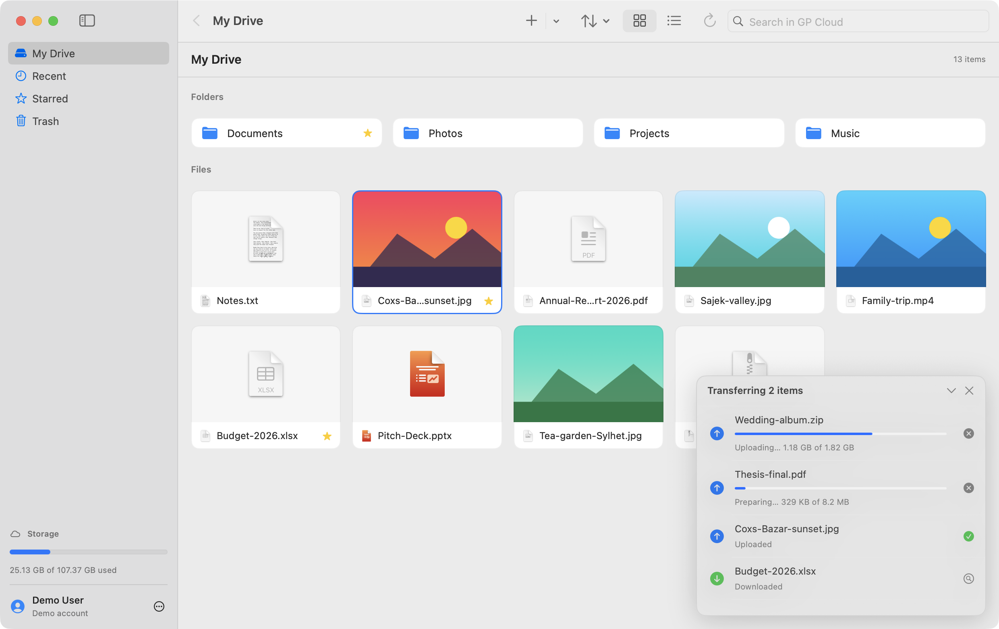
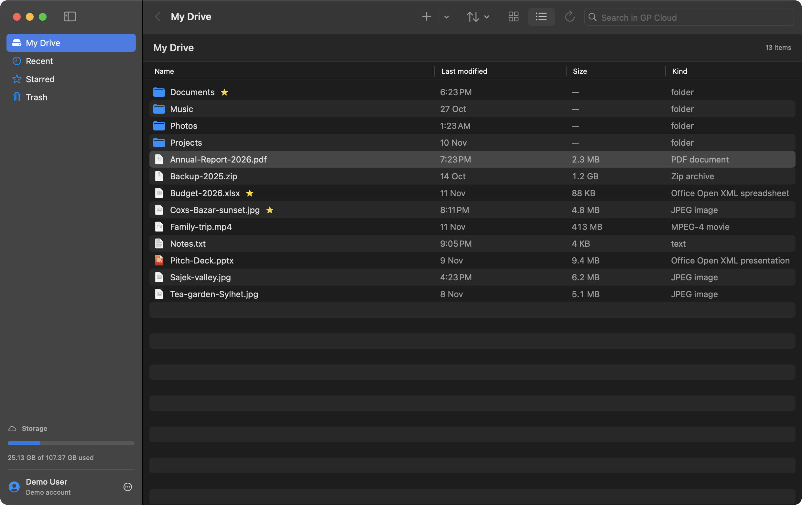
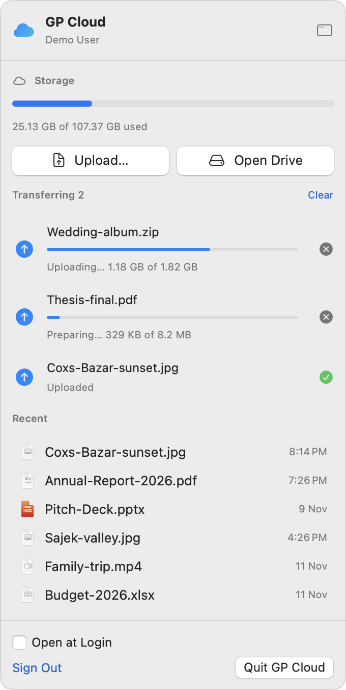

# GP Cloud Desktop

**Unofficial** desktop clients for [Grameenphone GP Cloud](https://gpcloud.grameenphone.com).

| Platform | Status |
|---|---|
| **macOS**: native SwiftUI app with a Google Drive-style browser and a menu bar extra | ✅ [Download](../../releases?q=macos) · `brew install --cask azs06/tap/gpcloud` |
| **Windows**: Tauri app (Rust + WebView2) with a Fluent-style UI and a tray icon | ✅ [Download](../../releases?q=windows) (setup.exe or .msi) |

> **Not affiliated with, endorsed by, or supported by Grameenphone.** "GP Cloud" and "Grameenphone" belong to their owners.
> These apps talk to undocumented APIs that can change at any time. Use at your own risk.

## macOS

<p align="center">
  
</p>

<table>
  <tr>
    <td width="66%"></td>
    <td width="34%"></td>
  </tr>
  <tr>
    <td align="center"><sub>List view (dark mode)</sub></td>
    <td align="center"><sub>Menu bar extra</sub></td>
  </tr>
</table>

<sub>Screenshots use the built-in demo mode with sample files. Regenerate them with <code>macos/scripts/screenshots.sh</code>.</sub>

### Features

- **My Drive**: breadcrumbs, a grid view (thumbnails for photos and videos), and a list view sortable by name, date or size
- **Upload files and whole folders**: drag from Finder, ⌘U, or the + button. Multipart uploads in parallel, with retries and instant (dedup) uploads
- **Download** with progress, **Open** in the default app, **Quick Look** (Space)
- New folder, rename, move, copy, star, **Trash** (restore, delete forever, empty), search, **Recent**, **Starred**
- **Menu bar extra**: storage meter, live transfers, quick upload, recent files, Open at Login. Closing the window keeps the app running in the menu bar (turn this off under View → Show in Menu Bar)
- Keyboard shortcuts: ⌘1–4 switch sections, ⌘↑ goes up a folder, ⌫ moves to Trash, Space for Quick Look, ⌘R refreshes, ⇧⌘N makes a new folder
- Universal (Apple Silicon and Intel), macOS 14 Sonoma or later

### Install

#### Homebrew

```sh
brew install --cask azs06/tap/gpcloud
```

Upgrade with `brew upgrade --cask gpcloud`. The cask clears the download quarantine, so the app opens normally.

#### Manual

1. Download `GPCloud-<version>-macOS.zip` from [Releases](../../releases?q=macos) and unzip it.
2. Move **GPCloud.app** to `/Applications`.
3. First launch: the app is ad-hoc signed and **not notarized**, so macOS will block a double-click. Either
   - right-click the app → **Open** → **Open**, or
   - run `xattr -dr com.apple.quarantine /Applications/GPCloud.app`.

### Signing in

Click **Sign in**. GP Cloud's own login page opens inside the app (phone number, password or OTP, 2FA). After you sign in, the app reads the session's access token from the web session. **The app never sees or stores your password.** GP Cloud's servers refresh the token. Sign Out (⋯ menu at the bottom of the sidebar, or the menu bar) deletes the app's GP Cloud cookies.

### Build from source

Only Command Line Tools are needed; Xcode isn't required. Run these from `macos/`:

```sh
./scripts/build-app.sh            # universal app → dist/GPCloud.app
ARCHS=arm64 ./scripts/build-app.sh  # faster, Apple Silicon only
./scripts/package-release.sh      # → dist/GPCloud-<version>-macOS.zip + .sha256
swift run -c release gpcloud-selftest   # offline tests for the hashing/upload math
./scripts/screenshots.sh          # regenerate docs/screenshots/macos from demo mode (screen must be awake)
```

**Demo mode:** run the app with `GPCLOUD_DEMO=1` to see sample files without an account.
`GPCLOUD_DEMO_VIEW=grid|list|menubar` and `GPCLOUD_DEMO_APPEARANCE=light|dark` pick what's shown.

> Recent Command Line Tools ship a macOS 26.5 SDK that can't import WebKit with Swift 6.3.3
> (`could not build Objective-C module 'std'`). The build script uses `MacOSX15.4.sdk` when it exists.
> Set `GPCLOUD_SDK=/path/to/sdk` to override. If you run `swift build`/`swift run` yourself and hit that error,
> prefix the command with `SDKROOT=/Library/Developer/CommandLineTools/SDKs/MacOSX15.4.sdk`.

### Known limitations

- **Copy Public Link** and **Copy To** follow the Android app's requests but haven't been tested much. The share link's `validity` unit is a guess (7 days).
- GP Cloud doesn't allow spaces or `<>|:"*?/\` in names. Uploads replace spaces with `_` and drop the other characters. The rename and new-folder dialogs explain the rule and offer to fix the name.
- Empty (0-byte) files are rejected by the service.
- **Open at Login** needs the app in `/Applications`.

## Windows

### Features

- **My Drive** in a grid (photo and video thumbnails) or a list, with breadcrumbs and sorting by name, date or size
- **Upload files and whole folders**: drag from Explorer or use **New** → Upload. Multipart uploads in parallel, with retries and instant (dedup) uploads
- **Download** with progress, open files in their default app, and show downloads in Explorer
- New folder, rename, move, copy, star, **Trash** (restore, delete forever, empty), search, **Recent**, **Starred**
- **System tray icon**: open the app, upload files or a folder to My Drive, and see storage used in the tooltip. Closing the window keeps GP Cloud running in the tray (quit from the tray menu)
- Keyboard: Delete, F2 rename, Enter open, Ctrl+A, Ctrl+F search, F5 refresh, Alt+↑ up, Ctrl+Shift+N new folder, Ctrl+U upload
- Light and dark themes follow Windows settings

### Install

Download `GPCloud-<version>-Windows-x64-setup.exe` (per-user install, no admin needed) or the `.msi` from [Releases](../../releases?q=windows).
The installer isn't code-signed yet, so SmartScreen may warn on first run: choose **More info** → **Run anyway**.
WebView2 ships with Windows 10/11; the installer fetches it if it's missing.

Signing in works like the Mac app: GP Cloud's own login page opens in a private window, and the app keeps only the resulting session cookie (in `%LOCALAPPDATA%\io.github.azs06.gpcloud-desktop`). Sign out deletes it.

### Build from source

Needs Node 20+ and Rust (the toolchain version is pinned in `windows/src-tauri/rust-toolchain.toml`). Run these from `windows/`:

```sh
npm install
npx tauri dev                     # run with hot reload (also works on macOS/Linux for development)
npx tauri build                   # installers → src-tauri/target/release/bundle/{nsis,msi}
cd src-tauri && cargo test --lib  # hashing/upload tests, cross-checked against the macOS client
```

**Demo mode:** `GPCLOUD_DEMO=1` shows sample files without an account.

### Known limitations

- Same service rules as on macOS: no spaces or `<>|:"*?/\` in names (uploads swap spaces for `_`), no 0-byte files, and **Copy public link** hasn't been tested live.
- x64 only for now.

## How it works

[docs/API.md](docs/API.md) documents the GP Cloud API that both clients use: the reverse-engineered protocol: the NextAuth login, every file endpoint, and the multipart upload. Each upload slice carries a SHA-256 *midstate* (`hashCtx`), plus a `proofCode` the server uses to check that the client has the file.

```
docs/API.md                        the reverse-engineered protocol (shared)
macos/                             Swift app (SwiftPM, no Xcode project)
  Sources/GPCloudKit/                API client + upload protocol (no UI)
  Sources/GPCloud/                   SwiftUI app: auth (WKWebView), drive, transfers, menu bar
  Sources/SelfTest/                  offline checks
windows/                           Tauri app
  src-tauri/src/hashing.rs           slicing, SHA-256 midstates, proofCode, name rules (+ tests)
  src-tauri/src/api.rs               API client, NextAuth session/cookie handling
  src-tauri/src/transfers.rs         upload/download queue with progress events
  src-tauri/src/lib.rs               commands, login window, tray
  src/                               Preact + TypeScript UI
```

Both clients' upload planners give byte-identical results on the same fixture (the Rust tests assert the values the Swift planner produces).

## License

[MIT](LICENSE)
